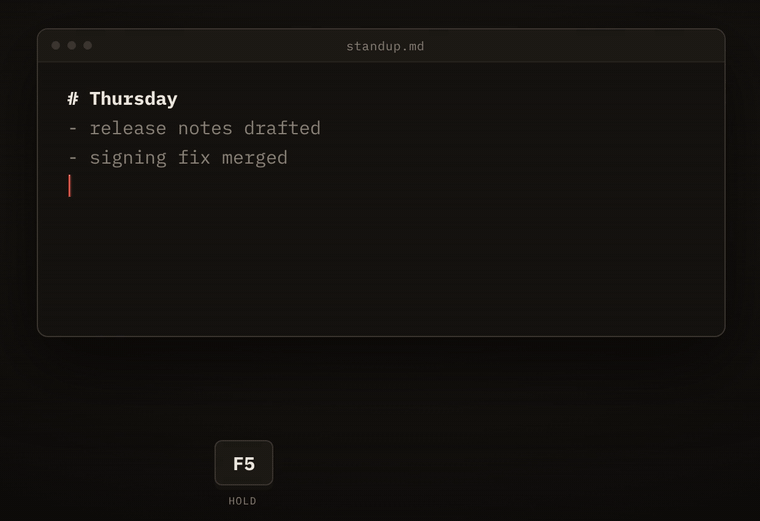

# DictateFlow

[](https://github.com/irfanfaraaz/dictateflow/actions/workflows/ci.yml)
[](https://github.com/irfanfaraaz/dictateflow/releases/latest)
[](LICENSE)


Voice dictation for macOS — speak into any app, get text. Built with Rust + Tauri 2.

Press a hotkey, talk, release. Your speech is transcribed via ElevenLabs Scribe v2 and pasted into whatever app has focus. A minimal floating waveform bubble shows at the bottom of your screen while recording.

https://github.com/user-attachments/assets/5edc93d7-3208-4905-bbb8-9e750da79cc0

<sub>Music in the demo: "Happy Beats / Business Moves Vol. 10" by Sascha Ende, [ende.app](https://ende.app/en) ([CC BY 4.0](https://creativecommons.org/licenses/by/4.0/)).</sub>

**Contents:** [Download](#download) · [Setup](#setup) · [Usage](#usage) · [Stack](#stack) · [Development](#development) · [Notes](#notes) · [Contributing](#contributing) · [Licence](#licence)

## Download

### Recommended: one-line install (no Gatekeeper prompt)

Paste this into Terminal:

```bash
curl -fsSL https://raw.githubusercontent.com/irfanfaraaz/dictateflow/main/scripts/install.sh | bash
```

It downloads the latest `.dmg` from Releases, copies **DictateFlow.app** into `/Applications`, and launches it. Because the file is fetched with `curl` instead of a browser, macOS doesn't attach the quarantine flag, so the unsigned app opens without the "unidentified developer" warning. Run the same command again to update.

Prefer to do it by hand? Same idea, step by step (replace `0.3.1` with the [latest version](https://github.com/irfanfaraaz/dictateflow/releases/latest)):

```bash
curl -fL -o /tmp/DictateFlow.dmg https://github.com/irfanfaraaz/dictateflow/releases/download/v0.3.1/DictateFlow_0.3.1_aarch64.dmg
hdiutil attach /tmp/DictateFlow.dmg -nobrowse -mountpoint /tmp/dictateflow-dmg
ditto /tmp/dictateflow-dmg/DictateFlow.app /Applications/DictateFlow.app
hdiutil detach /tmp/dictateflow-dmg && open /Applications/DictateFlow.app
```

### Browser download

Or grab the latest `.dmg` from [**Releases**](https://github.com/irfanfaraaz/dictateflow/releases).

> **macOS Gatekeeper warning** — DictateFlow is not yet code-signed, so macOS will block it on first launch when downloaded through a browser. To open it:
>
> 1. Open the `.dmg` and drag DictateFlow to Applications
> 2. Open Terminal and run:
>    ```bash
>    xattr -cr /Applications/DictateFlow.app
>    ```
> 3. Now open DictateFlow normally
>
> You only need to do this once. The `xattr` command removes the quarantine flag macOS adds to downloaded apps.

### Requirements

- **macOS** on Apple Silicon (M1+)
- **ElevenLabs API key** ([elevenlabs.io](https://elevenlabs.io) — Scribe v2 access)

### Build from source

Requires Rust toolchain (`rustup`), Node.js 18+, and pnpm.

```bash
git clone https://github.com/irfanfaraaz/dictateflow.git
cd dictateflow
pnpm install
pnpm tauri build
```

The `.app` lands in `src-tauri/target/release/bundle/macos/DictateFlow.app` and the `.dmg` in `src-tauri/target/release/bundle/dmg/`.

## Setup

1. **Launch the app** — the Settings window opens.
2. **Add your ElevenLabs API key** in Settings → Engine. The key is stored in macOS Keychain.
3. **Pick your microphone** in Settings → Engine → Input Device (defaults to system default).
4. **Set your hotkey** in Settings → Hotkey (default: F5). Toggle or hold-to-talk modes.
5. **Grant permissions** when prompted:

| Permission | Why | How |
|---|---|---|
| **Microphone** | Audio capture during dictation | macOS prompts automatically on first use |
| **Accessibility** | Synthetic ⌘V to paste transcript | System Settings → Privacy → Accessibility → toggle DictateFlow ON |
| **Input Monitoring** | Global hotkey on F-row keys | System Settings → Privacy → Input Monitoring → toggle DictateFlow ON |

After granting Accessibility, **quit and relaunch** the app (macOS caches the grant per-process).

## Usage

1. Focus any text input (editor, browser, chat, terminal)
2. Press your hotkey — the floating bubble appears at the bottom of your screen
3. Speak naturally
4. Release the hotkey (or press again in toggle mode)
5. Text is pasted into the focused app

<p align="center"></p>

## Stack

| Concern | Choice |
|---|---|
| Desktop framework | Tauri 2.x |
| Frontend | React + Tailwind + framer-motion |
| Backend | Rust, Tokio async runtime |
| Audio | cpal → 16kHz mono → ring buffer |
| Transcription | ElevenLabs Scribe v2 realtime (WebSocket) |
| Local engine | whisper.cpp via whisper-rs (Metal) — optional |
| Secrets | macOS Keychain |
| Text injection | Clipboard + CGEvent ⌘V |

## Development

```bash
# Dev mode with hot reload
pnpm tauri dev

# Clippy lint (must pass with zero warnings)
cd src-tauri && cargo clippy --all-targets --all-features -- -D warnings

# Run tests
cargo test

# TypeScript check
npx tsc --noEmit
```

Logs are written to `~/Library/Logs/dictateflow/dictateflow.log.*`.

## Notes

- **Bluetooth earbuds**: Work, but the app correctly handles the HFP profile switch delay. If your earbuds have poor mic quality, use Settings to pick your built-in Mac mic instead.
- **Permissions surviving updates**: macOS ties Accessibility and Keychain access to the app's code signature. Releases are signed with a stable self-signed certificate (set up once with `scripts/setup-signing.sh`, which stores it as the `MACOS_SIGNING_P12` / `MACOS_SIGNING_P12_PASSWORD` repo secrets), so grants carry over between versions. Without those secrets, builds are ad-hoc signed and you must re-grant Accessibility after every update (remove DictateFlow with −, add it again with +, relaunch). Local `pnpm tauri build` builds are ad-hoc signed too.
- **Local Whisper engine**: Available but requires downloading a GGML model in Settings → Models. ElevenLabs Scribe is the primary engine.

## Contributing

Bug reports, ideas and pull requests are welcome. See [CONTRIBUTING.md](CONTRIBUTING.md) for setup and the checks CI runs, and [CHANGELOG.md](CHANGELOG.md) for what changed in each release. Please report security issues privately as described in [SECURITY.md](SECURITY.md). Everyone taking part follows the [code of conduct](CODE_OF_CONDUCT.md).

## Licence

[AGPL-3.0](LICENSE). You can use, change and share DictateFlow, but if you distribute a changed version, you must release its source under the same licence.
